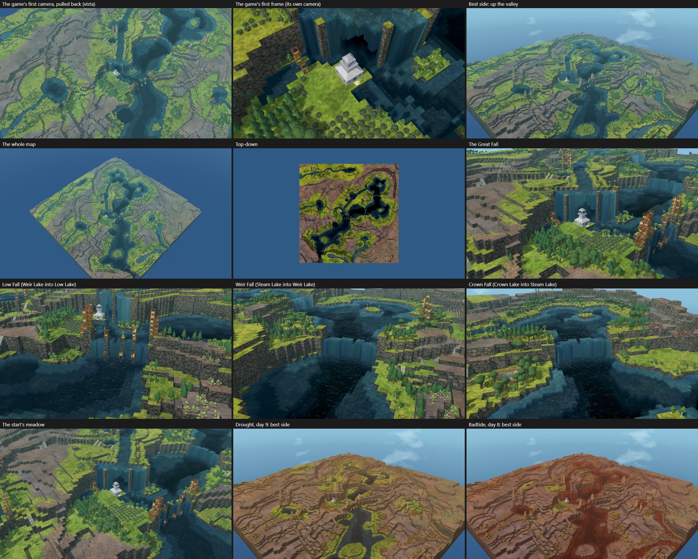

# Showcase craft (progress)

ROADMAP Wave 1: showcase-quality maps made by hand with the editor, to find what the tools can't yet do. Each round
makes maps in a real browser against the dev server (Generate, then the forces, brushes, Block tool and water tools),
logs every gap, closes the page's gaps and sends the rest to their owners on #236.

## The maps

| Round | Map | Theme | Character | Picture |
|---|---|---|---|---|
| 1 | Twin Falls Gorge | Canyon, 128² | A river gorge between mesas; two falls drop off the mesas, one onto a green terrace, one into the side channel; start on the high mesa with berries and oaks | [view](../sheets/showcase-1-twin-falls-gorge.jpg) |
| 1 | Caldera Lake | Highlands, 128² | Craterize on the high plateau, filled by two sources; a breach through the west wall drops the lake to level 11, so the central peak stands as an island and the terraces show as shores; the outflow joins the river below | [view](../sheets/showcase-2-caldera-lake.jpg) |
| 1 | Glacier Hollow | Highlands, 128² | Glaciate drawn down an existing valley in the high block: a U-trough with a chain of lakes and green benches, woods painted on them | [view](../sheets/showcase-3-glacier-hollow.jpg) |
| 2 | Glacier Hollow | Highlands, 128² | The trough rebuilt: four lakes stepping down it (8.2, 7.2, 5.5, 4.3) with a short fall between each, shores made irregular with freehand bays, woods on the moist rim | [view](../sheets/showcase-r2-glacier-hollow.jpg) |
| 2 | Twin Falls Gorge | Canyon, 128² | Each fall now fed by a winding stream 4–5 tiles wide and a level deep (bed two down, a lip at the fall); the upper sources moved back across the plateau | [view](../sheets/showcase-r2-twin-falls-gorge.jpg) |
| 2 | Caldera Lake | Highlands, 128² | The island raised to a peak 4.8 levels above the lake, its outline broken up; the straight breach replaced by one that winds through the rim at 11, falls 3 levels, then runs at 8 to the drop | [view](../sheets/showcase-r2-caldera-lake.jpg) |

All three maps above are retired (planning retired the hand-made maps after round 3a, below); Four Lakes, at the end of this page, was built from its idea.

## The gap log

One line per gap: where, what was meant, what happened, the cost to a player. Owner: page (this stream), milestone
(core, water, generator) or forces play (the look). Status: open, fixed (PR), sent (#236 comment).

| # | Where | Meant | Happened | Cost | Owner | Status |
|---|---|---|---|---|---|---|
| 1 | Carve, drawn from the mesa down into the gorge | A cut with a waterfall where it leaves the mesa | A bowl 20 tiles long and 5 deep, graded into a ramp; no fall | A waterfall needs Lower and a source placed by hand (3 tools, ~6 steps) | milestone | fixed (#934: Carve falls where its course leaves high ground: the stream on top a level deep with its bed two down, a one-level lip at the edge as wide as the stream (on Auto at most about six tiles), the high ground round it kept; Fall sets the height in one drop, Size the width) |
| 2 | Unleash on a source at the mesa's edge | Water runs off the edge as a fall | A click sent it the other way, over the mesa; the drawn course (drag from the button) bowled 12 tiles wide and left a 4-level step, no fall; the drag gesture is found only by reading the plan | Undo, then by hand as in 1 | milestone (course), page (gesture) | the course fixed (#934: the same fall as Carve's); the gesture fixed (#789: Unleash's tooltip says to drag onto the map) |
| 3 | Smart Lower from a source on flat ground | A channel one level below the ground, leading the water off | It read the source's 0.1-deep sheet as the pond and cut 2 tiles; message "Lower 2 tiles" | Undo the source, cut the channel dry, place the source again | page | fixed (#784) |
| 4 | Lower, Size 1.5, along a line | An even channel | Dotted edges: every third tile keeps the old level as a knob | A Smooth pass or hand clicks on each knob | page (core brush) | fixed (#787) |
| 5 | Moving the start | Press the house and drag it | Pressing the house model picks the ground 2 tiles behind it and starts a selection; with the Select tool open the start can't be grabbed at all | Close Select (X), find the start's own tile and press there | page | fixed (#771) |
| 6 | A way down from a 4-level mesa | A walkable ramp from the start to the land below | No ramp tool: a Slope is one level; a stair needs each tile lowered by hand (a second Lower pass on a tile already below its neighbours misses it) and 4 Slopes placed and turned one by one (~15 strokes, 4 items) | Start left on the mesa without a path down (380 walkable tiles, 2 mine sites out of reach) | page | fixed (#779: the Slope dragged down lays a stair; it takes the natural ramps' shape, treads of two to four tiles and the ground three wide) |
| 7 | Checks list fixes | Fix the three problems one after another | Each fix closes the list | Reopen the list for each fix | page | closed: doesn't happen on dev |
| 8 | Share link, Canyon 128² | A link in a moment | ~35 s on the third try | Waiting; looks broken | milestone (#672) | sent (#236, milestone) |
| 9 | Moisture green around water | Green that follows the water's shape | Near-perfect discs around sources and ponds | Looks stamped next to the game's irregular wet ground | forces play | closed: as the game draws it (the moisture is the game's on 99.7–100 % of tiles, and a lone source on flat ground wets a disc in the game too; on the cleanest frame the green/dry boundary wanders 0.49 tiles from the moisture contour in the game and 0.51 in ours, the edge 1.25 tiles wide in both; docs/progress/3d-view.md, "The green round water against the game's") |
| 10 | The hero picture (.timber thumbnail) | The map's best side | About 45% sky, the map corner-on from high up; the falls can't be seen | The map's picture in the game's list sells it short | forces play | sent (#236, forces play) |
| 11 | Flatten (Level 11, Ground) across a lake's rim | Cut a notch through the rim | Tiles under the lake's 0.1-deep edge count as wet, so the stroke skipped the rim (D322: Ground is dry tiles only) | One wasted stroke; redo in Both | page | closed: by design (D322) |
| 12 | Naturalize (Size 4, Strength 5) along a Flatten-cut outlet | Rough, natural banks | It changed 6 tiles; the banks stay ruler-straight | An outlet that looks dug by hand | milestone (D399) | sent (#236, milestone) |
| 13 | Flatten with a set Level below the ground under the pointer | The dab lands on the tile under the pointer | It aims on the target level's plane: top-down, dabs landed 1–2 tiles off and left one-tile pillars; at a low angle a dab on a 13 tile at Level 10 changed nothing | Undo; precise notches can't be dabbed | page | fixed (#783) |
| 14 | Glaciate, Size Auto (30) at 128² | A U-trough down the drawn valley | It lowered nearly the whole 45×60 high block into one basin lake; Size 14 gives the trough | Undo, then guess a Size | milestone | sent (#236, milestone) |
| 15 | Reset view and middle-drag while Top-down is on | Reset to the usual angle; middle-drag tilts | Reset view stays top-down and middle-drag does nothing, with no hint | Confused several times; press Top-down again | page | fixed (#785: middle-drag orbits out of Top-down); Reset view keeps the mode by design (D184) |
| 16 | Esc while "Opening your map…" after Generate | Cancel and keep the settings just picked | It cancels, and the panel's Theme and seed go back to the old map's | Pick the settings again | page | fixed (#786) |
| 17 | Rectangle selection in the orbit view | A one-row box | It took 6 rows: the box is drawn on the screen, not on the ground | Undo; every exact box made in Top-down | page | closed, by design: the box runs between the tiles under the press and the release (at a slant the release lands rows away); its outline and "w × h tiles" show live |
| 18 | A box dragged in Select, zoomed out in Top-down, starting 2–3 tiles from a water source | A selection | The drag grabbed and moved the source (4 times in one session) | A silent change to the water, seen only in History; worked round with Hide objects | page | fixed (with Select open, a box begun beside a source selects; a press on the source still takes it) |
| 19 | Building lakes that step down a trough | Each lake one level below the last | A lake stands at its notch plus the flow's head (a notch at 5 gave 5.5); the only readout of a lake's level is hovering one tile; two lakes ended level with each other until the outlet's own spill was cut | About 12 Flatten and Fill edits and many height readings for one chain of 4 lakes | page (idea: the Wand on water says the lake's level) | fixed: the hover readout names the water's level, "Water at level 5.5, 0.5 deep, bed level 5" (the Wand takes a whole chain of lakes at once, so it can't name one) |
| 20 | A stream cut one level into a plateau | Water that reads as a stream | 0.08 deep, a wet sheet: a stream needs its bed two levels down and a one-level lip where it falls | One more pass for each stream, found only by reading the depths | page | closed, as the game plays it: a shallow flow spreads thin, and the hover readout now shows its depth (gap 19); for a stream about a level deep, cut the bed two down and leave a one-level lip at the fall (Smart Lower can't tell where the fall is, so a lip it guessed would be wrong as often as right); Carve and Unleash now cut that stream and lip themselves at a fall (#934) |
| 21 | Mixed woods painted on a dry plateau | Woods on the rim | They're drawn withered (dry soil), with no note while painting; the checks report them afterwards | Undo, then repaint on moist ground | page | closed, no gap: the ring turns amber and says "dry ground: these will die" (D235); missed while painting by script |
| 22 | A freehand outline traced along a lake's sill | Bays along the shore | The outline's own tiles are always taken, so Fill up filled the sill's notch | Three notches cut again | page | closed, by design: the tiles the pointer traces are in the selection (what you see drawn); Alt+drag takes a notch back out |
| 23 | Naturalize (Size 4, Strength 5) over a stepped island, inside a selection, in Top-down | A rougher, natural island | No change, nothing in History, no word why | The island roughened by hand (9 Cut down and Fill up edits) | page | fixed: by design moist ground keeps its height (an island in a lake is all moist); a stroke that changes nothing now says so beside the pointer |
| 24 | Caldera Lake's round-1 project | A source on the ground | A Water source at 62,86 stands at z 3 under ground at 13, with water drawn on top at 14 and 17 | A buried source the game may not run | milestone | closed, no bug: the map's own spring cave (D488), floor 3, its water drawn at 4.1; the dump misread it |
| 25 | Craterize's rim (Caldera Lake) | A volcano's rim | Concentric terraces of even width all round: the reviewer read it as a stadium or a quarry | Hand work all round the rim to break it up | milestone (force shape) | sent (#236, milestone) |
| 26 | Highlands plateau after Glaciate (Glacier Hollow) | Benches carved by ice | 1–2-tile pillars and stair-stepped bands across the east plateau: the reviewer read them as noise | Smoothing tile by tile | milestone (force shape) | sent (#236, milestone) |
| 27 | Flatten (Level 11, Size 3) or a plain Lower on wet ground beside earlier Smart Lower channels (Smoke Isle) | A disc at 11 | The disc lands, but wet tiles round it drop to levels 2–3: shafts 9–10 deep. The same click on dry ground is clean. Reopening the saved project builds those tiles clean, so the live map and the saved file differ (D455) | Undo to before the water came, then shape the ground dry | milestone | sent (#236, milestone; repro project kept locally) |
| 28 | Erupt, Broad, Power 100, Size 90, Crater, in a 7-deep sea (Smoke Isle) | A volcano island | A ring island one level above the sea, peak 12 | Undo; Steep at Size 74 gives a cone to 22 | milestone (force shape) | sent (#236, milestone) |
| 29 | Unleash on the crater lake's source | Water spilling out of the crater | A bowl about 20 tiles wide cut through the cone's east half, 9 levels deep | Undo; a notch cut by hand (Flatten) | milestone | sent: same as gap 2 |
| 30 | The checks' fix for "Start overlapping another object" | The trees under the start removed | Refused: "The start is removed with its feature (deleteFeature it)": the fix picks the start itself | The start moved by hand to clear ground | page (checks) | open |
| 31 | A Slope stair dragged 16→14 across a 7-wide shelf at 15 | One stair down two levels | Refused: "foot would meet a wall": treads stop at 4 tiles, so the stair ends on the shelf | Two one-level stairs | page | open |
| 32 | Erupt's cone (Smoke Isle), with Ridges On and Heavy flows | A volcano | The reviewer saw a bullseye: even one-level terraces in concentric rings, no lobes, ridges or gullies, and grass to the summit with no bare rock or ash. Naturalize leaves it as it is (the cone is moist) | Not fixable by hand short of a rebuild | milestone (force shape) | sent (#236, milestone) |
| 33 | Deposit at the river's mouth into the rift (Rift Lake), Size Auto | A fan where the river meets the lake | Refused: "A force leaves caves and overhangs as they are: there is one at X 103 · Y 59": the ledge the Rift made a minute before. The rift's mouths, where a fan belongs, are where Rift leaves ledges | A smaller fan clear of the ledge (gap 34) | milestone (forces) | sent (#236, milestone) |
| 34 | Deposit, Size 16, drawn from the river mouth into the lake | A delta building out into the lake | 9 tiles raised to 3–5 under the water's surface (5.35) and a ledge behind cut from 11 to 8; nothing above water | Undone | milestone (forces) | sent (#236, milestone) |
| 35 | Rift (Power 70, Size Auto) across a 13-level plateau (Rift Lake) | A rift valley | The reviewer saw a box: two parallel, ruler-straight walls of one height, squared ends, a regular stair at the east end, a lone pillar in the lake, no shore at lake level. An Erode sweep on the south wall barely shows | Bays, beaches and a way down could be cut by hand; the box can't | milestone (force shape) | sent (#236, milestone) |
| 36 | Islands 256² (seed 7311) | A sea that runs off the map | A thin, straight land strip walls the sea along the east and south edges | Lower it by hand | milestone (generator) | sent (#236, milestone) |

Round 2's look review (a fresh reviewer, against PERFECT): Twin Falls Gorge reaches the bar (left to fix: a ruler-straight
north cliff and 1-tile notches on the east rims). Caldera Lake doesn't: its island reads as a stepped pyramid. Glacier
Hollow is close: its trough needs to read as one U-shape. Round 3 takes these on.

Round 3a's look review (a fresh reviewer each, against PERFECT): neither new map (Smoke Isle, Islands 256²; Rift Lake,
Highlands 128²) reached the bar, both for the force's shape (gaps 32 and 35). Planning then retired the hand-made maps:
a seed with one force in a corner falls short of the bar however it's finished, so the next map is built from its idea at
the scale of the whole map.

## Four Lakes: a map built from its idea

Sheet: [showcase-four-lakes.jpg](../sheets/showcase-four-lakes.jpg), from our own renderer (the high look, real Chrome
on the GPU), not the game's. Principles it was built against: [MAPCRAFT.md](../MAPCRAFT.md); the premise as a design for
the generator: [PREMISES.md](../PREMISES.md).

- **What it is.** 192², four lakes stepping down a valley over falls of about four levels, and a landmark fall of eight
  with a cave behind it, all in the game's first frame.
- **The question.** A badtide comes down the whole stair in a day unless the gates at the top are closed and the old
  channel opened.
- **How it was made.** From blank ground by operations only (`tools/showcase/four-lakes.ts`; the design by number is
  `four-lakes-design.ts`; D342, and the saved project replays to the same map byte for byte, D455), in fourteen rounds,
  each judged on captures in the game. Where DGM has no tool for what the map needs, the script has a helper marked
  "TOOL:"; the gaps are below. How to run it: `tools/README.md`, "Showcase maps".

**Latest measures (r14; all by the core's own checks and its water, not played).** Settled on the stacked engine in
1,536 ticks; 0 blocking, 2 warnings (caves on 26 tiles, `start.dry`). Flat 42.8 %, one-level steps 63.9 %, water 20.8 %,
green or wet on day 1 60.4 %. Falls 3.93, 3.77, 3.99 and the Great Fall 7.95 levels (12 tiles wide), whole in the first
frame (its lip at v 0.98), the cave behind it 91 blocks. 2,199 living trees (597 per 10,000), 736 dead in twelve woods.
The start: 262 logs grown within 20 tiles' walk (Easy asks 250), 86 berry bushes. Natural storage 1,215 against a need
of 380.

**The irrigation ladder** (`--irrigate`, cumulative; every count is by the model: the game's own what-if is not run).
"Green or wet" counts tiles; the first row is the map as it opens.

| Rung | The work | Kind | Green or wet gained |
|---|---|---|---|
| Day 1 | none | | 22,277 tiles, 60.4 % of the map (water 20.8 %, moist 39.7 %) |
| Small | the notch on Crag Brook: 4 blockages | notch | 478 tiles (1.3 %), 84 of them water: Hill Tarn, Hill Brook, the bench's kettle |
| Small | the notch on Birch Brook: 4 blockages | notch | 544 (1.5 %) |
| Small | the notch on South Brook: 3 blockages | notch | 431 (1.2 %) |
| Medium | the West Leat's blockage: 3 tiles (its gate for the badtide) | leat | 1,512 (4.1 %), 425 of them water: High Tarn, High Brook's bed |
| Small | a dam in High Brook's bed: 5 tiles, one level, once the West Leat runs | dam to pond | 269 (0.7 %) |
| Small | a levee at High Tarn's spill point: 8 tiles, once the West Leat runs | levee | 265 (0.7 %) |
| Medium | the Steam Leat's blockage: 3 tiles | leat | 1,056 (2.9 %), 140 of them water: Bench Tarn, Bench Brook's bed, the South Leat |
| Large | the old channel: 3 blockages (16, 6, 8 tiles) and 3 gates | bypass | about 1,382 within its water's reach |
| Dry for good | the south-east's limestone benches: succulents only | | the remaining 23.6 % (dry benches, crags and ridges) |

Totals: day 1 60.4 %; the small works 5.4 %; the two leats 7.0 %; the old channel 3.7 %; the rest 23.6 %. A raised sill
on a lake (11 to 17 tiles; r13: Weir +597, Steam +1,334, Crown +865, Low +1,415 of water) and the megadam in the Gate's
slot (5 long, 6 high; r13: 3,043 tiles of land under water) are r13's measures, not re-run in r14. The count of a rung
moves with how far the what-if's canonical settle fills a slowly fed basin (the Steam Leat's rung measured 1,186, 1,970
and 1,056 on three builds of the same works), so read a rung as about, not exactly.

**The first badtide at the start** (`--firstbad`, an 8-day badtide on the settled water; by the model): left alone the
Still Pool's water is bad on day 1 and all of it by day 4; with one levee on its neck (built while the water is clean)
it stays clean for all 8 days (15.0 of water on day 1, 0.71 deep; 5.1 on day 8) and the bench beside the start stays
31 % green at its worst (59 % in a drought). With the old channel opened and the three gates shut no lake is bad in 8
days and the start's water stays clean; with the three notches and the bypass open, Low Lake is half bad on day 3 and
75 % bad on day 8, and Weir, Steam and Crown Lake and the start stay clean.

**What still falls short.**
- The first badtide is harsh at the start: soil within seven tiles of the bay goes bad whatever is built (bad water
  contaminates soil 7 tiles out, and a level climbed costs 5 of them), so a third of the bench, the door included, is
  lost until the gates are shut. The Still Pool's levee keeps 31 % of the bench green, 40 % of what is green on day 0,
  not most of it; the pool is a few days' water for a young colony (0.7 deep), not a reservoir.
- The dry uplands read plain from the far view: stepped benches and dead woods, little colour.
- Nobody has played ten cycles: the start's generosity, the scarcity after it and the walk between the lakes are judged
  by the model and by captures, not by a played colony. The Workshop's starts have a bench of 640 to 980 level tiles;
  this one has 538.
- r14 itself was not judged in the game: its pool, piers, dead woods and old waterlines are seen only in our own sheet.
- Our view draws a pond and a green ring in High Tarn's hollow that the core's settled water does not have, and cuts the
  cliff away over a cave, so the fall over the cave cannot be judged in it.

**Tool gaps its authors logged** (each is a helper in the script; the authors' full log has the cases):
1. No blank or sketch start: the land came from a design function, set level by level.
2. No readout of the moist and bare share, and no tool that shows why ground is dry.
3. No lake-by-level tool: sill, crest, notch, shoulders, plunge pool and rim guard are all hand-built.
4. No channel tool with a bed that follows the land and banks that hold; no leak finder for stray water.
5. An object placed by operation refuses uneven ground; the script searches for level ground itself.
6. On an imported (blank-start) map `built.start` is unset, so `mapStartWaterDays` has no start to read; the script
   passes the tile itself.
7. `terrain.dam_wall` blocks a hand-made map for a ring of rock round a spring pool (it was written for the
   generator's stamped dam sites).
8. A failing case for the core's owners: with one cave on the map, closed hollows near the top water hold water that no
   source feeds, which the same map without the cave has dry (the stacked pre-fill fills them and the stacked settle
   does not take the water back); the script runs Remove unfed water on them. A seep placed on open ground in the cave
   build made the canonical settle end unsettled at its cap.
9. No what-if for the weather: "the bypass opened on a full valley" had to be a hazard run from the saved water.
10. A seep or a spring has no basin tool: a seep on open ground runs off wherever the land falls.
11. No route tool: nothing says where the walk from the start ends or what would join it, and no natural way to cross
    water.
12. No light check for a landmark: nothing in the editor shows how dark the first frame's water is.
13. No what-if for a dam: what a raised sill, a mended breach or a megadam holds had to be a flood fill in the script.
14. Our view cuts the cliff away over a cave, so a fall over a cave cannot be judged in it.
15. (r14) The what-if's canonical settle ends as settled before a slowly fed basin is full, so a rung's count moves with
    the basin's volume.
